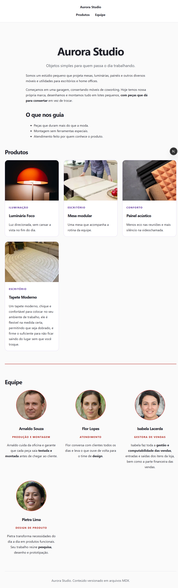

# Entrega: Aurora Studio

## Como executar
```bash
npm ci
npm run dev        
npm run check      
npm start          
Node 22+ (o .nvmrc sugere 24). Não será necessário login nem variáveis de ambiente.

## O que fiz
- Home `/` com apresentação (`content/paginas/empresa.mdx`), 3 produtos e 3 integrantes, vindos de arquivos MDX.
- Rota `/produtos/[slug]` com título, imagem, metadados e corpo MDX; slug inexistente mostrando o 404.
- Schema em `cms/estrutura.json` com as coleções `paginas`, `produtos` e `equipe`.
- Componentes `ProductCard` e `TeamCard`, que recebem tudo por props (sem catálogo fixo).
- Estados vazios: mensagem por coleção. Se `empresa.mdx` não existir, a home mostra o título "Aurora Studio" e um aviso explícito na tela.
- Navegação por links âncora (`/#produtos`, `/#equipe`) no layout.

## Capturas de tela



## Verificações
- `npm run check`: (

> lab-react-mdx@1.0.0 check
> npm run lint && npm test && npm run build


> lab-react-mdx@1.0.0 lint
> eslint .


> lab-react-mdx@1.0.0 test
> node --conditions=react-server --test tests/*.test.mjs

✔ separa metadados e corpo, preservando JSX e acentos (64.1979ms)
✔ descobre novos documentos, ordena por slug e ignora outros arquivos (80.6279ms)
✔ documento ausente retorna null e coleção sem pasta retorna lista vazia (15.3021ms)
✔ impede leitura por slugs fora da convenção e coleções desconhecidas (19.5097ms)
✔ não oculta YAML inválido como se fosse documento inexistente (27.3009ms)
✔ recusa schema apontando para fora da convenção de conteúdo (16.0734ms))
- Rolagem horizontal a 390 px: (não há / há)
- Teclado: (Tab percorre os links e cards com contorno de foco visível)
- Imagens: todas têm `alt` descrevendo a foto.

## Teste 
(Descreva o que você fez: Para o teste, criei um novo produto -tapete moderno- a e nova membra da equipe -Isabela Lacerda-, sem alterar o js.)

- Visual: mantive o CSS base do lab, mas coloquei uns frufus em cada card de produto - borda roxa em volta de cada card - e também uma borda vermelha em volta das fotos da equipe, além de toda a área da equipe ser vermelha, hoovers do header com a respectiva cor de produtos e equipe, e a centralização do título e corpo do texto.

## Caminho do conteúdo, do arquivo até a tela
`content/produtos/mesa-modular.mdx` → `lib/content.mjs` (`getContent`/`listContent`, no servidor) → `app/page.js` ou `app/produtos/[slug]/page.js` → `ProductCard` / `EditorialContent` → HTML no navegador.

## "Quiz"


**1. O que o `estrutura.json` controla e o que precisa ser implementado em React/Next.js?**  
O `estrutura.json` organiza as coleções, documentos e seus campos. Ele não cria as páginas, então no React/Next.js é necessário desenvolver as rotas, componentes, estilos e definir como essas informações serão exibidas.

**2. Qual a diferença entre coleção, slug, rota e pasta de imagens?**  
Coleção é um grupo de documentos, como `produtos`. Slug é o nome que identifica um documento, como `mesa-modular`. Rota é o endereço da página no site, como `/produtos/mesa-modular`. A pasta de imagens é onde ficam as imagens usadas nessa página.

**3. Como o frontmatter difere do corpo MDX?**  
O frontmatter reúne informações do documento, como nome, categoria e imagem. O corpo MDX contém o conteúdo principal da página, que será exibido no site. O `gray-matter` separa essas duas partes.

**4. Por que a leitura e a renderização ficam no servidor?**  
Porque o sistema precisa acessar os arquivos do projeto, algo que é feito no servidor. Assim, o conteúdo é preparado antes de ser enviado ao navegador. O `"use client"` é usado apenas nas partes que precisam de interação.

**5. O que acontece entre salvar no editor e ver a alteração no site publicado?**  
Ao salvar, a alteração fica armazenada como rascunho no navegador. Ao publicar, ela é enviada para o GitHub. Depois, o site é atualizado e uma nova versão é disponibilizada para os visitantes.